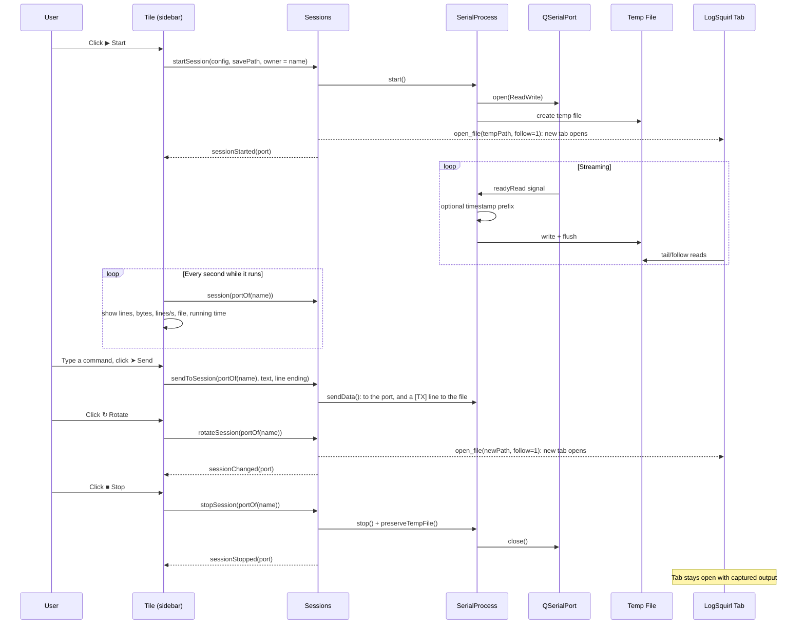
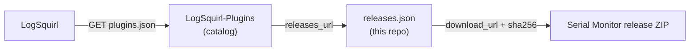

<!-- Allow GitHub's presentation markup and a logo before the main heading. -->
<!-- markdownlint-configure-file {"MD033": {"allowed_elements": ["div", "img"]}, "MD041": false} -->

<div align="center">


# Serial Monitor

**Every port its own tab.**

**A [LogSquirl](https://github.com/64x-lunicorn/LogSquirl) plugin that streams
serial data straight into the log viewer.**

Open several ports at once, set baud rate and parity per session, and read the
output with the same regex search and highlighters you use on any other log.

[](https://github.com/64x-lunicorn/LogSquirl-Serial/actions/workflows/ci-build.yml)
[](https://github.com/64x-lunicorn/LogSquirl-Serial/releases/latest)
[](https://github.com/64x-lunicorn/LogSquirl-Serial/releases)
[](#install)
[](LICENSE)

[Install](#install) &nbsp;/&nbsp;
[Usage](#usage) &nbsp;/&nbsp;
[Build](#build) &nbsp;/&nbsp;
[Architecture](#architecture) &nbsp;/&nbsp;
[Changelog](CHANGELOG.md)

</div>

---

## Why this plugin?

A serial console shows you the last screenful and forgets the rest. Piping to a
file means you stop watching. This plugin puts the stream where your other logs
already are.

| Less setup | More signal |
| :--- | :--- |
| **Ports found for you.** Automatic enumeration with one-click refresh; virtual Bluetooth ports are hidden so the list stays short. | **Configure the link.** Baud rate, data bits, stop bits, parity and flow control, saved per port configuration. |
| **Saved configurations, one tile each.** Each is started and stopped from its tile in the Serial sidebar tab, and is there again after a restart. | **Every port its own tab.** Start as many tiles as you like — each opens its own LogSquirl tab in follow mode. |
| **Timestamped on arrival.** Optional `[YYYY-MM-DD HH:mm:ss.zzz]` prefix, for devices that send none. | **One capture a port.** A tile whose port another one captures says so, and which. |
| **Nothing lost on stop.** Captured output stays in the tab after the session ends. | **Filter with the host.** No filter UI of its own — LogSquirl's regex search and highlighters do it better. |
| **Written to disk.** Configurable log directory, automatic `YYYY-MM-dd_HHmmss_<port>.log` names, path remembered. | **A worked example.** Heavily commented reference implementation for the Plugin SDK. |

## Install

### From LogSquirl

*Plugins → Browse Plugins…* → **Serial Monitor** → **Install**. The archive is
downloaded, verified against its SHA-256 checksum and loaded — no file copying.

### From a release

Download the archive for your platform from the
[releases page](https://github.com/64x-lunicorn/LogSquirl-Serial/releases/latest)
and unpack it into LogSquirl's plugin directory:

| Platform | Plugin Directory |
|----------|-----------------|
| macOS    | `~/Library/Application Support/logsquirl/plugins/io.github.logsquirl.serial/` |
| Linux    | `~/.local/share/logsquirl/plugins/io.github.logsquirl.serial/` |
| Windows  | `%APPDATA%/logsquirl/plugins/io.github.logsquirl.serial/` |

### From source

See [Build](#build), then:

```bash
DEST="$HOME/Library/Application Support/logsquirl/plugins/io.github.logsquirl.serial"
mkdir -p "$DEST"
cp build/liblogsquirl_serial.dylib "$DEST/"
cp plugin.json icon.png "$DEST/"
```

Or `cmake --install build --prefix "$HOME/.local"`.

After installing, restart LogSquirl or re-scan via *Plugins → Manage Plugins…*.

### Screenshots still to take

The screenshots are taken when the plugin is first tried in LogSquirl 26.12;
until then each has a marked placeholder in [Usage](#usage):

| File | Shows |
|------|-------|
| `docs/images/sidebar.png` | The Serial sidebar tab: two tiles, one running with its counters, Send and Rotate, one stopped whose port the running one holds |
| `docs/images/dialog.png` | The configuration dialog: a configuration loaded, with its port, `115200 8N1`, flow control and log directory |

## Usage

<!-- screenshot: docs/images/sidebar.png — the Serial sidebar tab with two
     tiles: one running, one stopped whose port the running one holds
     ("… is in use by …"). -->

> **Screenshot pending:** the Serial sidebar tab. The screenshots of this
> README are listed under [Screenshots still to take](#screenshots-still-to-take).

1. **Enable the plugin** in *Plugins → Manage Plugins…* — check
   "Serial Monitor" and click OK.  (On first run, the plugin is
   auto-enabled if no other plugins are configured.)

2. **New configuration…** in the **Serial** sidebar tab opens the
   configuration dialog (so does *Plugins → Serial Monitor…*).  It is not
   modal: keep it open beside the tabs.

   <!-- screenshot: docs/images/dialog.png — the configuration dialog with a
        configuration loaded: port, 115200 8N1, flow control, log directory. -->

   > **Screenshot pending:** the configuration dialog.

   - **Name** — what the configuration is called on its tile.  Choosing a
     saved one fills in its settings.
   - **Port** — one of the ports found by the last scan (**⟳ Refresh**
     scans again), or type in any other, e.g. a device not plugged in yet.
   - **Settings** — baud rate, data bits, stop bits, parity, flow control,
     and whether each line gets a timestamp.  Pick a common baud rate or
     type any other rate the device needs (e.g. 74880 or 250000).  A new
     configuration proposes the defaults set in Configure (step 6).
   - **Log directory** — where the captures are written, named
     `YYYY-MM-dd_HHmmss_<portName>.log`.  Use **…** or type a full path
     (`~` is your home directory).  Left empty, captures go to the `logs`
     folder in the plugin's configuration directory, which the empty field
     shows.  Either way they are kept: the plugin never removes a file in
     the log directory.  Only when LogSquirl gives the plugin no
     configuration directory are captures temporary files, removed when
     LogSquirl quits — and then no configuration can be saved.
   - **Save** — the configuration gets a tile in the Serial tab, or its
     tile is updated.  A configuration you edit (opened with Edit… or
     chosen from the list) saved under another name is renamed, and so is
     its tile; that is refused while its capture runs (stop it first), and
     when another configuration already has the name.  For another
     configuration, use *New configuration…*.  **Delete** removes it.  The
     configurations are saved in `serial.ini` in the plugin's configuration
     directory, so they are there again after a restart.

3. **The tiles.** Each saved configuration is a tile showing its name, its
   port, its frame and flow control (e.g. `115200 8N1 · no flow control`).
   - **▶ Start** opens the port and captures into a new tab in LogSquirl,
     with live output in follow mode.  The tile turns green, and Delete is
     hidden while it runs.
   - **While it runs** the tile shows, updated every second, the lines per
     second and how long it has run, the lines written and the bytes
     received, the size of the current file, the size at which the next
     file starts and how many files it has started so far:

     ```
     running · 12 lines/s · 0:05:31
     1,234 lines · 56.7 KiB received
     file 61.2 KiB · new file at 1.0 GiB · 0 rotations
     ```
   - **Send** — type a command, choose its line ending (CRLF, LF, CR or
     none; CRLF unless you choose another) and click **➤ Send** or press
     Return: it goes to the tile's port and shows in the log as a `[TX]`
     line.
   - **↻ Rotate** goes on in a new log file, opened in a new tab; the old
     tab keeps its file.
   - **■ Stop** stops the capture.  The tab remains open with all captured
     output preserved.  A stopped tile shows its configuration only.
     **■ Stop all** at the top stops every tile.
   - **Edit…** opens the dialog with the configuration.  A capture that
     runs goes on with the settings it started with until it is stopped
     and started again.
   - **Delete** asks, then deletes the saved configuration.

4. **Control characters** — Lines end at `\n`, `\r\n` or a lone `\r`. Every
   other control character but tab (NUL padding, the ESC of a colour code,
   those in the garbage of a wrong baud rate) is written as a visible `\xNN` escape with
   two upper-case hex digits, e.g. `\x00` or `\x1B`, so the log file stays
   text and LogSquirl keeps decoding it as UTF-8.  Other bytes, a backslash
   among them, are written as they came.  A line that never ends is written
   out every 64 KiB, never in the middle of a UTF-8 character.

5. **Multiple ports** — Tiles on different ports capture at the same time,
   each into its own tab.  A port is captured by one tile at a time: while
   one captures it, every other tile on that port says so
   (`/dev/ttyUSB0 is in use by "board"`), and its Start is refused with a
   notification saying which configuration holds the port.

6. **Configure defaults** — *Plugins → Manage Plugins…* → select plugin →
   Configure.  Set the default baud rate and timestamps a new configuration
   proposes (any rate from 300 to 4000000; one missing from the list is
   added to it), and the size
   at which a log file is rotated: when a capture's file reaches it
   (1 GiB unless you choose another), the capture goes on in a new file,
   opened in a new tab.  *Never* turns the limit off.

## Prerequisites

- **LogSquirl** ≥ 26.03 with the plugin system enabled
- **Qt6** (Core + Widgets + SerialPort) — same version LogSquirl was built with
- **CMake** ≥ 3.16
- A C++17-capable compiler (GCC ≥ 9, Clang ≥ 14, MSVC ≥ 19.29)

## Build

```bash
# Clone
git clone https://github.com/64x-lunicorn/LogSquirl-Serial.git
cd LogSquirl-Serial

# Configure
cmake -B build -S . -DCMAKE_BUILD_TYPE=Release

# If Qt6 is not in PATH (e.g. Homebrew on macOS):
cmake -B build -S . -DCMAKE_BUILD_TYPE=Release \
  -DCMAKE_PREFIX_PATH="$(brew --prefix qt6)"

# Build
cmake --build build

# The shared library is in build/:
#   macOS:   build/liblogsquirl_serial.dylib
#   Linux:   build/liblogsquirl_serial.so
#   Windows: build/logsquirl_serial.dll
```

### Running Tests

```bash
cmake -B build -S . -DCMAKE_BUILD_TYPE=Release -DBUILD_TESTS=ON
cmake --build build
cd build && ctest --output-on-failure
```

## Architecture

```mermaid
graph TD
    subgraph LogSquirl Host
        H[MainWindow]
        SB[Sidebar Panel]
    end

    subgraph Plugin — C ABI Boundary
        P[plugin.cpp<br/>get_info / init /<br/>shutdown / configure]
        SW[SidebarWidget<br/>one ConnectionTile<br/>per saved configuration]
        PD[PortDialog<br/>edits a configuration]
        PS[ProfileStore<br/>serial.ini]
        S[Sessions<br/>session management]
        SP1[SerialProcess #1<br/>/dev/ttyUSB0]
        SP2[SerialProcess #2<br/>COM3]
    end

    H -- register_sidebar_tab --> P
    P -- creates --> S
    P -- creates --> PS
    P -- creates --> SW
    P -- creates --> PD
    SW -- "New configuration… / Edit…" --> PD
    SW -- lists, deletes --> PS
    PD -- saves, deletes --> PS
    SW -- "Start / Stop (owner = name),<br/>Rotate, Send" --> S
    SW --> SB
    S -- manages --> SP1
    S -- manages --> SP2
    SP1 -- writes --> TF1[Temp File #1]
    SP2 -- writes --> TF2[Temp File #2]
    TF1 -- open_file follow=1 --> H
    TF2 -- open_file follow=1 --> H
```

`ProfileStore` (`src/profiles.h`) owns the saved port configurations in
`serial.ini`; the dialog saves and deletes them through it, and the sidebar
shows one tile (`src/connectiontile.h`) for each, rebuilt whenever the store
changes. `Sessions` (`src/sessions.h`) runs the captures, one per port, and
keeps the port list. A tile starts its capture with its configuration's name
as the session's owner, and finds it again with `Sessions::portOf(name)` —
also after its port was edited. The views call `Sessions` and update on its
signals — `sessionStarted`, `sessionStopped`, `sessionChanged` (rotated) and
`portsChanged` — also when a session ends on its own. A running session's
counters (lines, bytes received, file size, rotations, size of the next
rotation, start time) are read from `Sessions::session(port)`: no signal
announces them, so the sidebar reads them once a second while some capture
runs, and shows them on its running tile with the lines per second and the
running time.

### Data Flow



### Key Design Decisions

| Decision | Rationale |
|----------|-----------|
| **Plugin type = UI** | The DataSource type is limited to 1 stream per plugin. UI type allows managing multiple independent streams. |
| **open_file() instead of push_line()** | Each port writes to its own temp file. The host opens each file with follow/tail mode → one tab per port. |
| **register_sidebar_tab()** | Plugin registers a sidebar widget that is always visible while the plugin is loaded: one tile per saved configuration, the pattern of LogSquirl-NATS, whose tile (`connectiontile.*`) it shares. |
| **Saved configurations, keyed by name** | A device is set up once and started with one click; sessions stay keyed by port (one capture a port), and remember the configuration that started them. |
| **QSerialPort** | Cross-platform, integrates with Qt event loop, no need for threading or external libraries. |
| **Optional timestamps** | Embedded devices often don't include timestamps.  The plugin can prepend reception time for correlation. |
| **No built-in filtering** | LogSquirl's regex search and highlighters are more powerful than any filter we could build. |
| **Bluetooth filtering** | Virtual Bluetooth serial ports are rarely useful for log capture and clutter the port list. |
| **Library name without extension** | `plugin.json` uses `"library": "logsquirl_serial"` — QLibrary resolves the platform suffix automatically. |

## Project Structure

```
logsquirl-serial/
├── CMakeLists.txt              # Standalone build — finds Qt6, builds shared lib
├── plugin.json                 # Plugin manifest (cross-platform)
├── LICENSE                     # GPL-3.0-or-later
├── README.md                   # This file
├── CHANGELOG.md                # Release history
├── .gitignore
├── include/
│   └── logsquirl_plugin_api.h  # Vendored SDK header (MIT license)
├── src/
│   ├── plugin.h                # Global state shared across translation units
│   ├── plugin.cpp              # C ABI entry points (get_info, init, shutdown)
│   ├── serialprocess.h         # Serial port discovery + per-port session wrapper
│   ├── serialprocess.cpp
│   ├── sessions.h              # Session management (start/stop/rotate), port list
│   ├── sessions.cpp
│   ├── profiles.h              # Saved port configurations and their store (serial.ini)
│   ├── profiles.cpp
│   ├── portdialog.h            # Dialog that edits a saved configuration
│   ├── portdialog.cpp
│   ├── sidebarwidget.h         # LogSquirl sidebar tab: a tile per saved configuration
│   ├── sidebarwidget.cpp
│   ├── connectiontile.h        # One tile: plain, knows nothing of serial ports
│   ├── connectiontile.cpp
│   ├── baudrate.h              # Editable baud rate combo of the dialog
│   └── baudrate.cpp
├── tests/
│   ├── CMakeLists.txt          # Catch2 test setup
│   ├── tests_main.cpp          # QApplication + Catch2 runner
│   ├── plugininfo_test.cpp
│   ├── parseportlist_test.cpp
│   ├── baudrate_test.cpp
│   ├── serialprocess_test.cpp
│   ├── sessions_test.cpp
│   ├── profiles_test.cpp
│   ├── connectiontile_test.cpp
│   ├── portdialog_test.cpp
│   ├── sidebarwidget_test.cpp
│   └── plugin_test.cpp
└── docs/
    └── DEVELOPER_GUIDE.md      # How to use this as a plugin template
```

## Plugin Registry

This plugin is listed in the
[LogSquirl-Plugins](https://github.com/64x-lunicorn/LogSquirl-Plugins) catalog,
so it installs from **Plugins → Browse Plugins…** with no manual file copying.

The catalog holds **one entry per plugin** and does not change between releases.
Versions, download URLs and checksums live in this repository's
[`releases.json`](releases.json) — update that when you publish a release, and
fill in every `sha256`: an empty checksum silently disables verification in the
host.



## Using This as a Plugin Template

This plugin is designed to be a starting point for your own LogSquirl plugins.
See [docs/DEVELOPER_GUIDE.md](docs/DEVELOPER_GUIDE.md) for a step-by-step
guide on how the Plugin SDK works, annotated code walkthroughs, and tips for
building your own plugins.

**Quick start to fork this as a template:**

1. Copy this directory
2. Rename the library in `CMakeLists.txt`
3. Update `plugin.json` with your plugin's identity
4. Modify `plugin.cpp` entry points
5. Replace `SerialProcess` + `Sessions` with your own logic
6. Build and install

## License

GPL-3.0-or-later — see [LICENSE](LICENSE) for the full license text.

The vendored `include/logsquirl_plugin_api.h` header is MIT-licensed, so
plugins of any license can build against the LogSquirl Plugin SDK without
taking on GPL obligations. See [NOTICE](NOTICE) for details.
