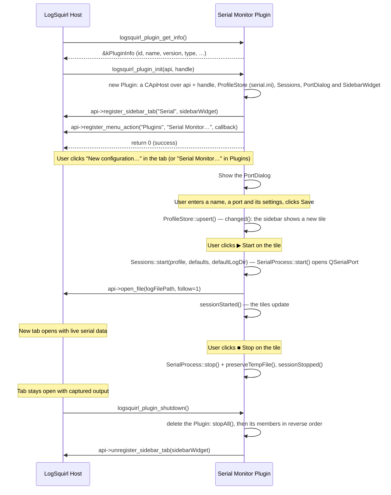

# Developer Guide — LogSquirl Serial Monitor Plugin

This guide explains how the Serial Monitor plugin works under the hood,
how the LogSquirl Plugin SDK is used, and how to adapt this code to
build your own plugin.

## Plugin SDK Overview

The LogSquirl Plugin SDK is a **pure C ABI** interface.  A plugin is a
shared library (`.dylib` / `.so` / `.dll`) that exports four C functions:

| Symbol | Purpose |
|--------|---------|
| `logsquirl_plugin_get_info()` | Return static metadata (called before init) |
| `logsquirl_plugin_init()` | Receive host API, set up the plugin |
| `logsquirl_plugin_shutdown()` | Tear down, release all resources |
| `logsquirl_plugin_configure()` | Open a settings dialog (optional) |

The host provides a function-pointer table (`LogSquirlHostApi`) that the
plugin uses to interact with the application.

## Plugin Lifecycle



## Class Diagram

```mermaid
classDiagram
    class Plugin {
        -CApiHost host_
        -size_t hostApiSize_
        -TemporaryFiles temporaryFiles_
        -ProfileStore profiles_
        -Sessions sessions_
        -PortDialog dialog_
        -OwnedWidget~SidebarWidget~ sidebar_
        -SidebarTab sidebarTab_
        +showDialog()
        +configureDefaults(parent)
    }

    class SerialConfig {
        +QString portName
        +qint32 baudRate
        +DataBits dataBits
        +StopBits stopBits
        +Parity parity
        +FlowControl flowControl
        +bool timestamps
    }

    class SerialProcess {
        -SerialConfig config_
        -QIODevice* device_
        -CaptureLog log_
        +start()
        +stop()
        +sendData(data, lineEnding) bool
        +rotateLog(partialLine) QString
        +preserveTempFile()
        +isRunning() bool
        +portName() QString
        +tempFilePath() QString
        +lineCount() qint64
        +totalLineCount() qint64
        +receivedBytes() qint64
        +fileSize() qint64
        +rotationCount() int
        +nextRotationSize() qint64
        +startTime() QDateTime
        +discoverPorts()$ QStringList
        +filterPorts()$ QStringList
    }

    class CaptureLog {
        -QTemporaryDir tempDir_
        -QFile file_
        +CaptureLog(timestamps, clock, maxLineLength)
        +open(port, savePath, tempRoot, error) bool
        +discard()
        +close() bool
        +rotate(partialLine, error) QString
        +isOpen() bool
        +path() QString
        +keepTempDir() QString
        +setSizeLimit(bytes, reached)
        +hasReachedSizeLimit() bool
        +nextRotationSize() qint64
        +start(device)
        +receive(data) bool
        +send(command) bool
        +endPartialLine() bool
        +hasFailed() bool
        +writeError() QString
        +lineCount() qint64
        +totalLineCount() qint64
        +receivedBytes() qint64
        +fileSize() qint64
        +rotationCount() int
        +generateLogPath()$ QString
        +absoluteUserPath()$ QString
    }

    class Sessions {
        -QMap sessions_
        -QStringList ports_
        +startProblem(profile)$ QString
        +start(profile, defaults, defaultLogDir) QString
        +startSession(config, savePath, owner) bool
        +stopSession(port)
        +stopAll()
        +rotateSession(port)
        +sendToSession(port, data, lineEnding) bool
        +isSessionActive(port) bool
        +activeSessionCount() int
        +activePorts() QStringList
        +session(port) SerialProcess*
        +isRunning(name) bool
        +runningCheck() IsRunning
        +stop(name)
        +rotate(name)
        +send(name, data, lineEnding) bool
        +captureOf(name) SerialProcess*
        +portInUse(port) QString
        +ports() QStringList
        +refreshPorts()
        sessionStarted(port)
        sessionStopped(port)
        sessionChanged(port)
        portsChanged()
    }

    class PortProfile {
        +QString name
        +SerialConfig serial
        +QString logDir
    }

    class Defaults {
        +qint32 baudRate
        +bool timestamps
        +int maxFileMiB
    }

    class ProfileStore {
        +ProfileStore(configDir, isRunning)
        +defaults() Defaults
        +saveDefaults(defaults) QString
        +defaultLogDir() QString
        +list() QList~PortProfile~
        +find(name) optional~PortProfile~
        +newProfile() PortProfile
        +upsert(profile) QString
        +remove(name) QString
        changed()
    }

    class PortDialog {
        +newConfiguration()
        +editConfiguration(name)
    }

    class SidebarWidget {
        +reload()
        +tile(name) ConnectionTile*
        +refresh()
        newConfigurationRequested()
        editRequested(name)
    }

    class ConnectionTile {
        +name() QString
        +setSummary(lines)
        +setDetails(lines)
        +setState(TileState)
        +setControls(widget)
        startClicked()
        stopClicked()
        editClicked()
        deleteClicked()
    }

    Sessions --> SerialProcess : creates & manages
    ProfileStore ..> Sessions : asks isRunning(name)
    ProfileStore --> PortProfile : saves
    ProfileStore --> Defaults : saves
    PortProfile --> SerialConfig : has
    PortDialog --> ProfileStore : saves, deletes
    SidebarWidget --> ProfileStore : lists, deletes
    SidebarWidget --> ConnectionTile : one per profile
    SidebarWidget --> Sessions : starts, stops, view of
    SerialProcess --> SerialConfig : uses
    SerialProcess --> CaptureLog : opens, rotates, feeds bytes and commands
    Plugin --> Sessions : owns
    Plugin --> ProfileStore : owns
    Plugin --> PortDialog : owns
    Plugin --> SidebarWidget : owns
```



The C entry points reach the parts through one global, a pointer to the
`Plugin` that `init()` creates and `shutdown()` deletes
([`src/plugin.cpp`](../src/plugin.cpp)). Its members are declared in the order
they depend on each other — the host, the temporary files, the captures, the
settings (which ask the captures what runs), the dialog, the sidebar, its tab
registration — so destroying it
unregisters the tab while its widget lives, and destroys each part before those
it uses; its destructor first stops the captures, while every part that shows
them is there. When LogSquirl quits (`aboutToQuit`), the temporary files go
last, after the captures closed them. A failing `init()` undoes itself the same
way: the members made so far go again, in reverse, as the exception leaves the
constructor. The rest of the plugin asks `plugin.h` for the running host
(`pluginHost()`) and the size of its table (`hostApiSize()`).

The sidebar and the dialog hold no session state of their own: they call
`Sessions` and refresh on its signals, and both stay in step when a session
ends on its own (device unplugged, log file not writable). A running session's
counters change on every line, so no signal announces them: the sidebar reads
them from `Sessions::captureOf(name)` on a timer of its own, which runs only
while some session runs.

## Key Implementation Details

### Saved configurations

A configuration ([`src/profiles.h`](../src/profiles.h), `PortProfile`) is a
name, a `SerialConfig` (port, baud rate, data bits, stop bits, parity, flow
control, timestamps) and a log directory. The size at which a log file is
rotated is not part of it: it is Configure's, for every capture
(`Sessions::start()` adds it at Start, from `ProfileStore::defaults()`).

`ProfileStore` is the one owner of `serial.ini`, in the configuration
directory it is given (the host's `get_config_dir`); no other code knows the
file or its keys. It keeps the defaults Configure saves (group `serial`:
`defaults()`, `saveDefaults()`, which says why when it cannot save), the
configurations, as the array `profiles`, in the order they were first saved,
and the log directory saved last; `defaultLogDir()` is `logs` in the
configuration directory. The Configure dialog is UI over it, and a capture
gets its size limit from it at Start: the serial capture does not know the
file exists. Settings are saved as text (`8`, `1.5`, `even`,
`rtscts`), and one that is not a setting loads as its default. `upsert()`,
`rename()` and `remove()` return why they failed in words for the user, empty
when they did, and emit `changed()` when they did; `remove()` and `rename()`
refuse a configuration that captures (the plugin gives the store
`Sessions::runningCheck()` to ask): its session's owner is its name, so renaming it
would part the tile from its capture. `rename(oldName, profile)` replaces the
configuration where it is in the list, and refuses a name another one has.
`newProfile()` proposes Configure's baud rate and timestamps, and the log
directory saved last (`serial/logDir`, where the sidebar of earlier versions
kept its one log directory). Without a configuration directory, nothing is
saved, and the dialog says why.

The dialog ([`src/portdialog.h`](../src/portdialog.h), `PortDialog`) edits
them: a name (choosing a saved one fills in its settings), the port (the ports
of the last scan, or any typed in), the settings and the log directory, with
Save and Delete. Save refuses, on the status line, a configuration without a
name, without a port, without a baud rate, or with a log directory that is not
a full path (`Sessions::startProblem()`, which a Start refuses the same way). It
remembers the saved configuration it edits
(chosen, opened with Edit…, or saved last; none after *New configuration…*):
Save under another name renames that one (`ProfileStore::rename()`), so its
tile is renamed rather than joined by a second. It starts nothing: the tiles
do.

### The sidebar tab and its tiles

The tab "Serial" ([`src/sidebarwidget.h`](../src/sidebarwidget.h)) is
registered with `register_sidebar_tab` at init and unregistered at shutdown.
It holds *New configuration…*, *Stop all*, and one tile per saved
configuration in the order they were saved, rebuilt whenever the store saves
or deletes one (`ProfileStore::changed`), from the dialog or from a tile.

- **The tile** ([`src/connectiontile.h`](../src/connectiontile.h)) is
  LogSquirl-NATS's: a plain `QFrame` that knows nothing of serial ports — a
  state dot, a title, a summary, details, Start / Stop, Edit… and Delete,
  with a signal for each button. The tab sets its texts and its `TileState`;
  a serial capture is stopped or running (`Connecting` and `Failed` are
  unused). Keep the two copies alike. This copy adds `setControls(widget)`:
  controls of the running capture, which the tile shows below the details
  while it runs and hides otherwise; it knows nothing of what they do.
- **Summary**: the port, then the frame and flow control,
  `115200 8N1 · no flow control` (`frameOf()`, `flowControlName()`).
- **Details** while its capture runs, from its `SerialProcess` counters:

  ```
  running · 12 lines/s · 0:05:31                      rate, running time
  1,234 lines · 56.7 KiB received                     totalLineCount(), receivedBytes()
  file 61.2 KiB · new file at 1.0 GiB · 0 rotations   fileSize(), nextRotationSize(), rotationCount()
  ```

  The running time counts from `startTime()`; *no size limit* replaces
  *new file at* when `nextRotationSize()` is 0. Lines per second are the
  lines written since the refresh before, divided by the time since then; a
  start counts from 0. Sizes and numbers are written in the user's locale.
  A stopped tile shows its main facts only: no details, but
  `<port> is in use by "<name>"` (`Sessions::portInUse()` of the port its
  configuration has saved now) while another configuration captures its
  port.
- **Live**: a `QTimer` calls `refresh()` once a second while
  `Sessions::activeSessionCount()` is above 0, and stops when the last
  session ends; a start, stop or rotation (`sessionStarted`,
  `sessionStopped`, `sessionChanged`) updates the tiles at once, and so does
  a Send. Tests call `refresh()` instead of waiting for the timer.
- **Controls** of a running tile (`controlsFor()`): a command field
  (`command`), the line ending (`lineEnding`: CRLF, LF, CR, none), ➤ Send
  (`send`; Return in the field too) and ↻ Rotate (`rotate`). Send calls
  `Sessions::send(name, text, lineEnding)` and empties the
  field once it is sent; a failure is told by `Sessions`' notification and
  the text stays. Rotate calls `Sessions::rotate(name)`. The
  line ending chosen and the command typed but not sent yet are kept by name
  in the sidebar, so a tile rebuilt by a save or delete of another
  configuration keeps them; neither is saved with the configuration.
- **A tile and its session.** Sessions are keyed by port: a port runs one
  capture at a time. Start makes the configuration's name the session's
  owner (`Sessions::start(profile, defaults, defaultLogDir)`), and from then
  on the tile addresses it by that name — `Sessions::stop(name)`,
  `rotate(name)`, `send(name, …)`, `captureOf(name)` for the live details —
  not through the port saved in the configuration, which may have been
  edited while it runs (the capture then goes on with the settings it
  started with, as the dialog says, until it is stopped and started again).
  For a name that captures nothing, as after its capture has just ended,
  each of them does nothing and tells nothing; the sidebar keeps no port of
  its own for a configuration. A second tile on a busy port
  is refused by `Sessions`, with a notification naming the configuration
  that holds the port; no refusal is silent.
- **Start** finds the configuration in the store and hands it, with the
  store's defaults and default log directory, to `Sessions::start()` in one
  call. That checks it (`Sessions::startProblem()`: no port, no baud rate, a
  log directory that is not a full path), takes the capture's settings from
  it and the size limit from the defaults, picks a new file
  `YYYY-MM-dd_HHmmss_<port>.log` in its log directory (or the default one; a
  temporary file without either), whose directory the capture creates when
  it opens it, refuses a port that captures already and a file another
  capture writes to, and returns why it did not start: the user has been
  told so once, as a warning, or as the capture's error for a port or log
  file that does not open. **Delete** asks (`QMessageBox`), then
  deletes through the store; it is hidden while the capture runs, and the
  store refuses then too. **Edit…** and **New configuration…** emit
  `editRequested(name)` and `newConfigurationRequested()`, which the plugin
  connects to the dialog.
- Every slot the host's event loop runs goes through `guarded()`
  ([`src/host.h`](../src/host.h)): the tiles' buttons, the timer, and
  `Sessions`' handlers of what a `SerialProcess` reports (`finished`,
  `errorOccurred`, `sizeLimitReached`), which write files and rescan the
  ports. An exception there is logged; it would end LogSquirl.
- `Sessions`, `SerialProcess` and the sidebar reach LogSquirl only through
  the `Host` they are handed ([`src/host.h`](../src/host.h)): log, notify,
  `warn()` (log and notify the same text, for a refusal), open a followed
  tab, the configuration directory and the temporary root. The plugin hands
  them `CApiHost`, the adapter over the host's C table; the tests hand them a
  `FakeHost` (`tests/fakehost.h`), which records every call.

### Serial Port Discovery

`SerialProcess::discoverPorts()` uses `QSerialPortInfo::availablePorts()`
to enumerate ports.  The `filterPorts()` method excludes:

- **Bluetooth virtual ports** — matched by description or manufacturer
  containing "bluetooth" (case-insensitive)
- **Phantom entries** — ports with no system location

### Data Streaming

When a session starts:

1. Its `CaptureLog` ([`src/capturelog.h`](../src/capturelog.h)) opens one
   log file for the capture, never two (`CaptureLog::open()`): the
   configured save path (appended to, so Stop and Start keep the earlier
   capture; refused if it is not a full path), or, when there is none, a
   new temp file `serial_<portName>.log` in a `QTemporaryDir` of its own,
   named after the process: `logsquirl-serial-<pid>-XXXXXX`
   (`src/tempdirs.h`). Only a regular file is opened: a FIFO, a symlink or
   a device is refused, without blocking. A file it creates is readable by
   the user only.
2. `QSerialPort` is configured and opened in `ReadWrite` mode (Send needs
   to write); if it cannot be, the log file is discarded again (removed if
   the start created it)
3. The `readyRead` signal triggers `onReadyRead()`, which hands what it read
   to the `CaptureLog`. The serial capture is an adapter: it reads the port
   and sends to it, says what failed, and stops; it holds no file or
   rotation state of its own. `CaptureLog` decides what is written:
   - `\n`, `\r\n` and a lone `\r` end a line, a CRLF split across two reads
     included; a lone CR ends its line at once
   - A line that never ends is forced out at 64 KiB, before a UTF-8
     character whose last bytes have not arrived yet
   - If timestamps are enabled, `[YYYY-MM-DD HH:mm:ss.zzz] ` is prepended
   - Control characters but tab are written as `\xNN` escapes
   - A command sent (`sendData(data, lineEnding)`, the line ending per call)
     is written as a `[TX] ` line, after the part of a line received so far,
     so that the rest of it is not joined to the command
   - It counts the lines, bytes and rotations the session's counters show
   - Each line is written to that one log file, flushed after each read for
     real-time tailing

A port error (and, for the substitute device the tests hand a
`SerialProcess` in place of its `QSerialPort`, a read that fails), a log
file that cannot be written, and a rotation that leaves no file each end the
session from the event loop, told once.

### Rotation and the size limit

`CaptureLog::rotate()` (↻ Rotate, or `SerialProcess::rotateLog()`) closes
the current file, which stays on disk for its tab, and opens a new one that
must not exist yet: next to a save path, a new `generateLogPath()` name
(`<yyyy-MM-dd_HHmmss>_<port>.log`, numbered within a second); in the
temporary directory, `serial_<port>_<n>.log`. The part of a line received so
far is written out first, or kept for the new file (`PartialLine::Keep`, at
the size limit). If the new file cannot be created, the capture goes on in
the old one, reopened, and the session says so; if that cannot be reopened
either, the capture has ended (`isOpen()` false) and the session stops.

With a size limit (`SerialConfig::maxFileBytes`, `setSizeLimit()`), the
`CaptureLog` asks for a rotation after the line that makes the file reach
it. The session emits `sizeLimitReached()` from the event loop, unless the
file was rotated or the session stopped meanwhile, and `Sessions` rotates
keeping the partial line. A rotation that fails leaves the next request due
once the file has grown by the limit past the end of that line, not on
every line.

### Timestamp Format

When enabled, each line is prefixed:

```
[2026-03-25 14:30:00.123] Original serial data here
```

This uses `QDateTime::currentDateTime()` — the timestamp reflects when
LogSquirl **wrote** the line, once its end had arrived, not when the device
sent it. `CaptureLog` takes the clock as a constructor argument, so its tests
fix the time.

### Session Persistence

When the user clicks Stop:

1. `preserveTempFile()` keeps the temporary directory
   (`CaptureLog::keepTempDir()`)
2. `stop()` closes the serial port and flushes remaining data
3. The `SerialProcess` is deleted, but the temp file remains on disk
4. The LogSquirl tab continues to display all captured data

The file stays until LogSquirl quits, also when the plugin is disabled or
updated at runtime, since its tabs stay open. A plugin instance loaded later
knows nothing of the files of the one before, but the process ID in the
directory name does: when LogSquirl quits, the plugin removes every directory
with its own process ID, and at `init()` those whose process no longer runs,
e.g. after a crash.

## Building Your Own Plugin

1. **Copy this directory** — it's a complete, standalone CMake project
2. **Update `plugin.json`** — give your plugin a unique `id`, `name`, etc.
3. **Rename the library** in `CMakeLists.txt` (`logsquirl_serial` → your name)
4. **Implement your logic** — replace `SerialProcess` with your data source
5. **Keep the C ABI** — the four exported functions must be present
6. **Use the host API** — `open_file()`, `log_message()`, `show_notification()`
7. **Register UI** — `register_menu_action()` for menu items, or
   `register_status_widget()` for status bar widgets

### Minimal plugin.cpp

```cpp
#include "logsquirl_plugin_api.h"

static const LogSquirlPluginInfo kInfo = {
    "com.example.myplugin", "My Plugin", "1.0.0",
    "Description", "Author", "MIT",
    LOGSQUIRL_PLUGIN_UI, LOGSQUIRL_PLUGIN_API_VERSION,
};

extern "C" {

LOGSQUIRL_PLUGIN_EXPORT const LogSquirlPluginInfo* logsquirl_plugin_get_info( void )
{
    return &kInfo;
}

LOGSQUIRL_PLUGIN_EXPORT int logsquirl_plugin_init( const LogSquirlHostApi* api, void* handle )
{
    api->log_message( handle, LOGSQUIRL_LOG_INFO, "Hello from my plugin!" );
    api->register_menu_action( handle, "Plugins", "My Plugin…", &myCallback, nullptr );
    return 0;
}

LOGSQUIRL_PLUGIN_EXPORT void logsquirl_plugin_shutdown( void )
{
    // Cleanup
}

LOGSQUIRL_PLUGIN_EXPORT void logsquirl_plugin_configure( void* parent_widget )
{
    // Optional: open a settings dialog
}

} // extern "C"
```

## Testing

The plugin uses [Catch2 v2](https://github.com/catchorg/Catch2/tree/v2.x)
with BDD-style macros (`SCENARIO` / `GIVEN` / `WHEN` / `THEN`).

Tests are compiled with the plugin sources linked directly into the test
binary — no need to load the `.dylib` at runtime.

```bash
cmake -B build -S . -DBUILD_TESTS=ON
cmake --build build
cd build && ctest --output-on-failure
```

CI also runs the tests in Debug on Linux x64 under AddressSanitizer and
UndefinedBehaviorSanitizer, without leak detection (`"sanitizers": true` in
`.github/plugin-ci.json`); a sanitizer report fails the build.

### Test Categories

| Tag | Description |
|-----|-------------|
| `[plugininfo]` | Verify C ABI metadata struct |
| `[filterports]` | Port list filtering logic |
| `[discoverports]` | Port discovery integration |
| `[capturelog]` | The log file and what is written to it from the bytes received and the commands sent: framing, UTF-8, escapes, timestamps, `[TX]` lines, counters, a device that refuses writes; in-process, without a port |
| `[files]` | `CaptureLog`'s log file: the save path or the temporary directory, regular files only, keeping the directory, discarding the file of a start that failed |
| `[rotation]` | `CaptureLog::rotate()`: file naming, the partial line, the fallback to the old file and the end of the capture, against read-only directories |
| `[sizelimit]` | `CaptureLog`'s size limit: asked for after the line that reaches it, re-armed past that line, again after a failed rotation |
| `[serialprocess]` | SerialProcess construction and defaults; what it tells of a device, log file or rotation that fails and of the size limit, against a substitute device; a few end-to-end scenarios over a pseudo-terminal |
| `[counters]` | `CaptureLog`'s counters, a session's, and a running tile showing them |
| `[sessions]` | Session bookkeeping in `Sessions`, a session's owner, a busy port |
| `[start]` | `Sessions::start()` from a saved configuration: each refusal in words, the serial settings and log path it derives, two configurations never writing to one file |
| `[byname]` | Stop, Rotate, Send and the live details by configuration name, and a quiet no-op for a configuration that does not capture |
| `[signals]` | `Sessions`' signals, and the views that follow them |
| `[hostapi]` | `CApiHost`, the `Host` of the C ABI, `warn()` and `guarded()` |
| `[host]` | What `Sessions` logs and notifies on the `Host` it is handed, once each |
| `[profiles]` | `serial.ini` and its store: the defaults, the saved configurations, the log directory, a file of 0.6.0, against a temporary directory without a host |
| `[tile]` | The tile on its own: states, buttons, controls, colours |
| `[portdialog]` | The dialog: save, edit, delete, what it refuses |
| `[sidebarwidget]` | The sidebar tab: tiles created, updated, deleted; Start and Stop against pseudo-terminals, two at once, a busy port; a running tile's counters, Rotate and Send |
| `[plugin]` | The entry points; configurations surviving a restart; the sidebar opening the dialog |

A modal question a click opens (a tile's Delete) is answered from a timer
started before the click (`tests/modal.h`).

A tile's counters are read by `SidebarWidget::refresh()`, which the tests
call rather than wait for the sidebar's one-second timer; one test checks
the timer itself, with a generous timeout. The lines per second are checked
by sending lines and refreshing until a rate shows, then refreshing until it
drops to 0, so no test depends on how fast the runner is.
