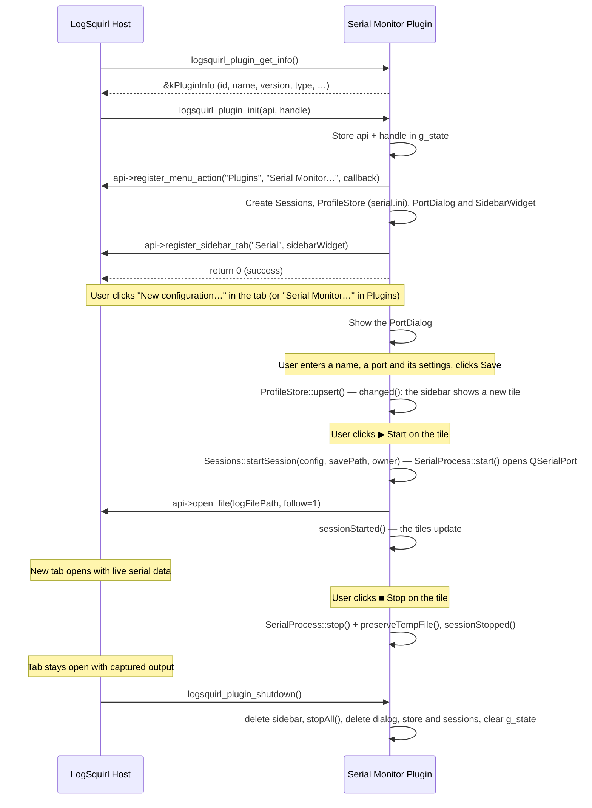
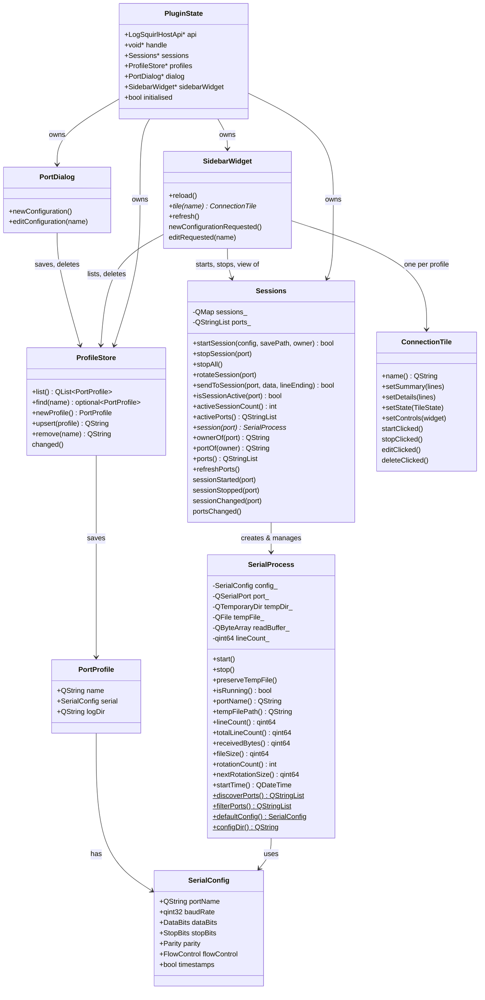

# Developer Guide — LogSquirl Serial Monitor Plugin

This guide explains how the Serial Monitor plugin works under the hood,
how the LogSquirl Plugin SDK is used, and how to adapt this code to
build your own plugin.

## Plugin SDK Overview

The LogSquirl Plugin SDK is a **pure C ABI** interface.  A plugin is a
shared library (`.dylib` / `.so` / `.dll`) that exports four C functions:

| Symbol | Purpose |
|--------|---------|
| `logsquirl_plugin_get_info()` | Return static metadata (called before init) |
| `logsquirl_plugin_init()` | Receive host API, set up the plugin |
| `logsquirl_plugin_shutdown()` | Tear down, release all resources |
| `logsquirl_plugin_configure()` | Open a settings dialog (optional) |

The host provides a function-pointer table (`LogSquirlHostApi`) that the
plugin uses to interact with the application.

## Plugin Lifecycle



## Class Diagram



The sidebar and the dialog hold no session state of their own: they call
`Sessions` and refresh on its signals, and both stay in step when a session
ends on its own (device unplugged, log file not writable). A running session's
counters change on every line, so no signal announces them: the sidebar reads
them from `Sessions::session(port)` on a timer of its own, which runs only
while some session runs.

## Key Implementation Details

### Saved configurations

A configuration ([`src/profiles.h`](../src/profiles.h), `PortProfile`) is a
name, a `SerialConfig` (port, baud rate, data bits, stop bits, parity, flow
control, timestamps) and a log directory. The size at which a log file is
rotated is not part of it: it is Configure's, for every capture
(`sessionConfig()` adds it at Start).

`ProfileStore` is the one owner of the configurations: they are saved in
`serial.ini` in the directory the host's `get_config_dir` gives, as the array
`profiles`, in the order they were first saved, next to the defaults Configure
saves (group `serial`). Settings are saved as text (`8`, `1.5`, `even`,
`rtscts`), and one that is not a setting loads as its default. `upsert()`,
`rename()` and `remove()` return why they failed in words for the user, empty
when they did, and emit `changed()` when they did; `remove()` and `rename()`
refuse a configuration that captures (the plugin gives the store
`Sessions::portOf()` to ask): its session's owner is its name, so renaming it
would part the tile from its capture. `rename(oldName, profile)` replaces the
configuration where it is in the list, and refuses a name another one has.
`newProfile()` proposes Configure's baud rate and timestamps, and the log
directory saved last (`serial/logDir`, where the sidebar of earlier versions
kept its one log directory). Without a configuration directory, nothing is
saved, and the dialog says why.

The dialog ([`src/portdialog.h`](../src/portdialog.h), `PortDialog`) edits
them: a name (choosing a saved one fills in its settings), the port (the ports
of the last scan, or any typed in), the settings and the log directory, with
Save and Delete. Save refuses, on the status line, a configuration without a
name, without a port, without a baud rate, or with a log directory that is not
a full path (`startProblem()`). It remembers the saved configuration it edits
(chosen, opened with Edit…, or saved last; none after *New configuration…*):
Save under another name renames that one (`ProfileStore::rename()`), so its
tile is renamed rather than joined by a second. It starts nothing: the tiles
do.

### The sidebar tab and its tiles

The tab "Serial" ([`src/sidebarwidget.h`](../src/sidebarwidget.h)) is
registered with `register_sidebar_tab` at init and unregistered at shutdown.
It holds *New configuration…*, *Stop all*, and one tile per saved
configuration in the order they were saved, rebuilt whenever the store saves
or deletes one (`ProfileStore::changed`), from the dialog or from a tile.

- **The tile** ([`src/connectiontile.h`](../src/connectiontile.h)) is
  LogSquirl-NATS's: a plain `QFrame` that knows nothing of serial ports — a
  state dot, a title, a summary, details, Start / Stop, Edit… and Delete,
  with a signal for each button. The tab sets its texts and its `TileState`;
  a serial capture is stopped or running (`Connecting` and `Failed` are
  unused). Keep the two copies alike. This copy adds `setControls(widget)`:
  controls of the running capture, which the tile shows below the details
  while it runs and hides otherwise; it knows nothing of what they do.
- **Summary**: the port, then the frame and flow control,
  `115200 8N1 · no flow control` (`frameOf()`, `flowControlName()`).
- **Details** while its capture runs, from its `SerialProcess` counters:

  ```
  running · 12 lines/s · 0:05:31                      rate, running time
  1,234 lines · 56.7 KiB received                     totalLineCount(), receivedBytes()
  file 61.2 KiB · new file at 1.0 GiB · 0 rotations   fileSize(), nextRotationSize(), rotationCount()
  ```

  The running time counts from `startTime()`; *no size limit* replaces
  *new file at* when `nextRotationSize()` is 0. Lines per second are the
  lines written since the refresh before, divided by the time since then; a
  start counts from 0. Sizes and numbers are written in the user's locale.
  A stopped tile shows its main facts only: no details, but
  `<port> is in use by "<name>"` while another configuration captures its
  port.
- **Live**: a `QTimer` calls `refresh()` once a second while
  `Sessions::activeSessionCount()` is above 0, and stops when the last
  session ends; a start, stop or rotation (`sessionStarted`,
  `sessionStopped`, `sessionChanged`) updates the tiles at once, and so does
  a Send. Tests call `refresh()` instead of waiting for the timer.
- **Controls** of a running tile (`controlsFor()`): a command field
  (`command`), the line ending (`lineEnding`: CRLF, LF, CR, none), ➤ Send
  (`send`; Return in the field too) and ↻ Rotate (`rotate`). Send calls
  `Sessions::sendToSession(portOf(name), text, lineEnding)` and empties the
  field once it is sent; a failure is told by `Sessions`' notification and
  the text stays. Rotate calls `Sessions::rotateSession(portOf(name))`. The
  line ending chosen and the command typed but not sent yet are kept by name
  in the sidebar, so a tile rebuilt by a save or delete of another
  configuration keeps them; neither is saved with the configuration.
- **A tile and its session.** Sessions are keyed by port: a port runs one
  capture at a time. Start passes the configuration's name as the session's
  owner (`Sessions::startSession(config, savePath, owner)`), and the tile
  finds its session with `Sessions::portOf(name)`, not through the port
  saved in the configuration, which may have been edited while it runs (the
  capture then goes on with the settings it started with, as the dialog
  says, until it is stopped and started again). A second tile on a busy port
  is refused by `Sessions`, with a notification naming the configuration
  that holds the port (`Sessions::ownerOf(port)`); no refusal is silent.
- **Start** finds the configuration in the store, says why when it cannot
  start (`startProblem()`), and starts its capture into a new file of its
  log directory (`savePathFor()`). **Delete** asks (`QMessageBox`), then
  deletes through the store; it is hidden while the capture runs, and the
  store refuses then too. **Edit…** and **New configuration…** emit
  `editRequested(name)` and `newConfigurationRequested()`, which the plugin
  connects to the dialog.
- Every slot the host's event loop runs goes through `guarded()`
  ([`src/plugin.h`](../src/plugin.h)): the tiles' buttons, the timer, and
  `Sessions`' handlers of what a `SerialProcess` reports (`finished`,
  `errorOccurred`, `sizeLimitReached`), which write files and rescan the
  ports. An exception there is logged; it would end LogSquirl.

### Serial Port Discovery

`SerialProcess::discoverPorts()` uses `QSerialPortInfo::availablePorts()`
to enumerate ports.  The `filterPorts()` method excludes:

- **Bluetooth virtual ports** — matched by description or manufacturer
  containing "bluetooth" (case-insensitive)
- **Phantom entries** — ports with no system location

### Data Streaming

When a session starts:

1. A `QTemporaryDir` is created for this session, named after the process:
   `logsquirl-serial-<pid>-XXXXXX` (`src/tempdirs.h`)
2. One log file is opened for the capture, never two: the configured save
   path (appended to, so Stop and Start keep the earlier capture), or, when
   there is none, a new temp file `serial_<portName>.log` inside that
   directory
3. `QSerialPort` is configured and opened in `ReadWrite` mode (Send needs
   to write)
4. The `readyRead` signal triggers `onReadyRead()`:
   - Data is read into a buffer
   - Complete lines (split on `\n`) are processed
   - If timestamps are enabled, `[YYYY-MM-DD HH:mm:ss.zzz] ` is prepended
   - Each line is written to that one log file
   - The file is flushed after each line for real-time tailing

### Timestamp Format

When enabled, each line is prefixed:

```
[2026-03-25 14:30:00.123] Original serial data here
```

This uses `QDateTime::currentDateTime()` — the timestamp reflects when
LogSquirl **received** the line, not when the device sent it.

### Session Persistence

When the user clicks Stop:

1. `preserveTempFile()` sets `tempDir_.setAutoRemove(false)`
2. `stop()` closes the serial port and flushes remaining data
3. The `SerialProcess` is deleted, but the temp file remains on disk
4. The LogSquirl tab continues to display all captured data

The file stays until LogSquirl quits, also when the plugin is disabled or
updated at runtime, since its tabs stay open. A plugin instance loaded later
knows nothing of the files of the one before, but the process ID in the
directory name does: when LogSquirl quits, the plugin removes every directory
with its own process ID, and at `init()` those whose process no longer runs,
e.g. after a crash.

## Building Your Own Plugin

1. **Copy this directory** — it's a complete, standalone CMake project
2. **Update `plugin.json`** — give your plugin a unique `id`, `name`, etc.
3. **Rename the library** in `CMakeLists.txt` (`logsquirl_serial` → your name)
4. **Implement your logic** — replace `SerialProcess` with your data source
5. **Keep the C ABI** — the four exported functions must be present
6. **Use the host API** — `open_file()`, `log_message()`, `show_notification()`
7. **Register UI** — `register_menu_action()` for menu items, or
   `register_status_widget()` for status bar widgets

### Minimal plugin.cpp

```cpp
#include "logsquirl_plugin_api.h"

static const LogSquirlPluginInfo kInfo = {
    "com.example.myplugin", "My Plugin", "1.0.0",
    "Description", "Author", "MIT",
    LOGSQUIRL_PLUGIN_UI, LOGSQUIRL_PLUGIN_API_VERSION,
};

extern "C" {

LOGSQUIRL_PLUGIN_EXPORT const LogSquirlPluginInfo* logsquirl_plugin_get_info( void )
{
    return &kInfo;
}

LOGSQUIRL_PLUGIN_EXPORT int logsquirl_plugin_init( const LogSquirlHostApi* api, void* handle )
{
    api->log_message( handle, LOGSQUIRL_LOG_INFO, "Hello from my plugin!" );
    api->register_menu_action( handle, "Plugins", "My Plugin…", &myCallback, nullptr );
    return 0;
}

LOGSQUIRL_PLUGIN_EXPORT void logsquirl_plugin_shutdown( void )
{
    // Cleanup
}

LOGSQUIRL_PLUGIN_EXPORT void logsquirl_plugin_configure( void* parent_widget )
{
    // Optional: open a settings dialog
}

} // extern "C"
```

## Testing

The plugin uses [Catch2 v2](https://github.com/catchorg/Catch2/tree/v2.x)
with BDD-style macros (`SCENARIO` / `GIVEN` / `WHEN` / `THEN`).

Tests are compiled with the plugin sources linked directly into the test
binary — no need to load the `.dylib` at runtime.

```bash
cmake -B build -S . -DBUILD_TESTS=ON
cmake --build build
cd build && ctest --output-on-failure
```

CI also runs the tests in Debug on Linux x64 under AddressSanitizer and
UndefinedBehaviorSanitizer, without leak detection (`"sanitizers": true` in
`.github/plugin-ci.json`); a sanitizer report fails the build.

### Test Categories

| Tag | Description |
|-----|-------------|
| `[plugininfo]` | Verify C ABI metadata struct |
| `[filterports]` | Port list filtering logic |
| `[discoverports]` | Port discovery integration |
| `[serialprocess]` | SerialProcess construction and defaults |
| `[counters]` | A session's counters, against a pseudo-terminal, and a running tile showing them |
| `[sessions]` | Session bookkeeping in `Sessions`, a session's owner, a busy port |
| `[signals]` | `Sessions`' signals, and the views that follow them |
| `[profiles]` | The saved configurations and their store, against a FakeHost's `serial.ini` |
| `[tile]` | The tile on its own: states, buttons, controls, colours |
| `[portdialog]` | The dialog: save, edit, delete, what it refuses |
| `[sidebarwidget]` | The sidebar tab: tiles created, updated, deleted; Start and Stop against pseudo-terminals, two at once, a busy port; a running tile's counters, Rotate and Send |
| `[plugin]` | The entry points; configurations surviving a restart; the sidebar opening the dialog |

A modal question a click opens (a tile's Delete) is answered from a timer
started before the click (`tests/modal.h`).

A tile's counters are read by `SidebarWidget::refresh()`, which the tests
call rather than wait for the sidebar's one-second timer; one test checks
the timer itself, with a generous timeout. The lines per second are checked
by sending lines and refreshing until a rate shows, then refreshing until it
drops to 0, so no test depends on how fast the runner is.
